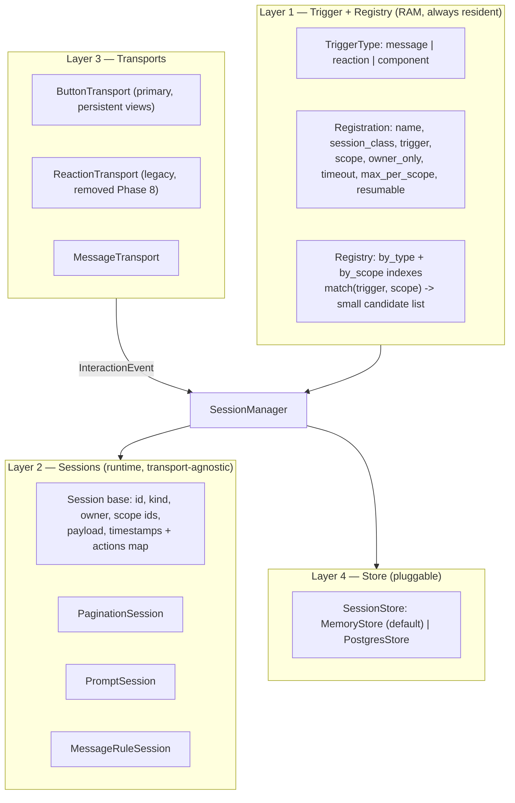
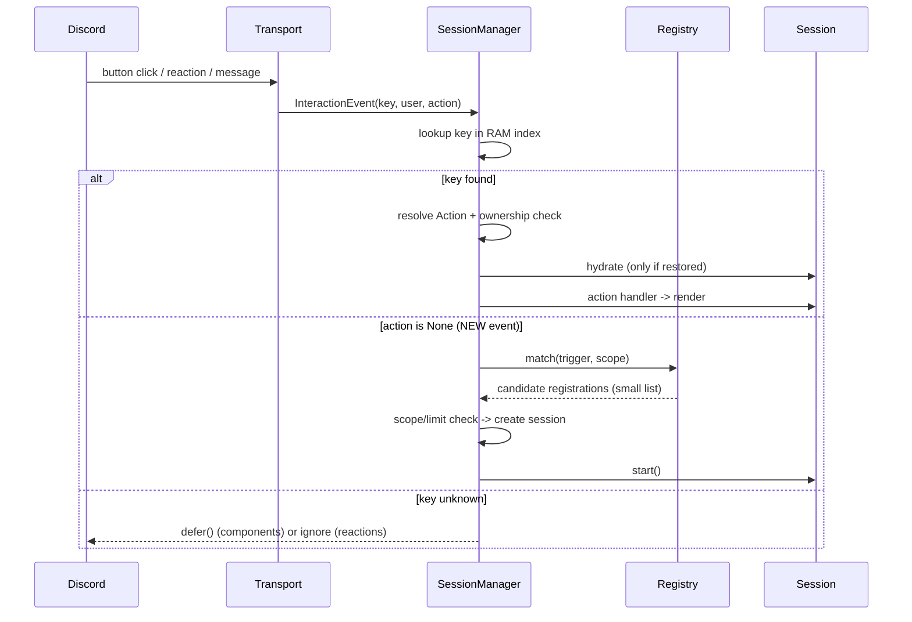

# Session Framework Refactor — Plan

Replaces `juliabot/scripts.py` (the `Script` class + `@Script.function` decorator) with a layered **Registration / Session** framework: a RAM trigger registry, transport-agnostic sessions (buttons first, reactions as legacy), pluggable persistence, and a Postgres-backed session store for restart resumability.

- **Epic branch:** `refactor/session-framework` (created from `main`)
- **Phases:** 9 (0–8), each on its own branch, each merged into the epic branch
- **Target runtime:** Python 3.10 (CI), discord.py 2.7, SQLAlchemy 1.4, Postgres in prod
- **Final merge:** epic branch → `main`

---

## 1. Goal & non-goals

### Goal

- Registration of a new dialogue/pagination/interaction is **declarative and short**.
- State is **typed and explicit** — no `cache: dict` bag, no magic `status` string/int protocol.
- Dispatch is **indexed**, not scanned: no list copies or linear scans per event.
- Ownership is **explicit per action**, defaulting to owner-only.
- Sessions can be **persisted and resumed** after a restart, efficiently.
- The framework is **transport-agnostic**: buttons (primary), reactions (legacy, temporary), messages (per-message triggers and durable channel entry points).

### Non-goals

- No declarative "dialogue definition as data" engine (flows defined in the DB). Code-defined sessions with declared payloads only. See §12.
- No sharding / multi-process support. Single instance. No Redis.
- No change to command syntax, embed content or user-facing wording beyond the button migration.
- No multi-tenant or per-guild plugin loading.

---

## 2. Confirmed decisions

| # | Decision | Notes |
|---|---|---|
| 1 | Persist **live session state** (resumability), not dialogue definitions | Interpretation of "Option A": the store holds runtime state, not flows |
| 2 | **Keep the per-message path**; every message is evaluated against the registry | The `on_message` trigger becomes a real, supported path in Phase 7 |
| 3 | **Buttons** (`discord.ui.View`) are the primary transport for new dialogues | The bot predates buttons; reactions are kept only as a temporary legacy transport |
| 4 | Ownership defaults to **`True`**, decided **per action** | Pagination `prev`/`next` are open to everyone; creation/deletion actions stay owner-only |
| 5 | Naming: **`Session`** (runtime) and **`Registration`** (code) | "Script" is retired entirely |

---

## 3. Environment constraints (verified)

These are facts from the repository and CI, and the plan is built around them.

| Constraint | Evidence | Consequence |
|---|---|---|
| Python **3.10** in CI | `.github/workflows/tests.yml` (`python-version: "3.10"`) | No `StrEnum`, `asyncio.timeout`, `Self`, `ExceptionGroup`. Use `class X(str, Enum)`, `typing.Protocol`, `from __future__ import annotations` |
| `black` + `isort --profile black` are CI gates | `tests.yml` formatting job | Run both before every commit; imports must be grouped |
| `pytest` 9.0 + `pytest-asyncio` 1.3, **no pytest config file** | `requirements-dev.txt`, no `pytest.ini`/`pyproject.toml` | Async tests need explicit `@pytest.mark.asyncio`; Phase 0 adds a config file pinning `asyncio_mode` and loop scope |
| Tests run with `DATABASE_URL=sqlite:///:memory:` | `tests/conftest.py` | Unit tests use SQLite; Postgres-only tests must be opt-in via marker + env var |
| CI only triggers on PRs/pushes **targeting `main`** | `tests.yml` (`branches: ["main"]`) | Phase PRs into the epic branch get **no CI** unless Phase 0 extends the workflow |
| Auto-merge (squash) is enabled for non-draft owner PRs | `.github/workflows/auto-merge.yml` | Phase PRs into the epic branch would auto-merge on open → **open phase PRs as drafts**, mark ready when verified |
| Prod DB is **Postgres**; `init_db()` auto-migrates | `juliabot/models.py`, `requirements.txt` (`psycopg2-binary`) | Adding one table is low-risk; the store must not use the global `session` object |
| `Client.setup_hook` exists and loads cogs | `juliabot/client.py` | The `SessionManager` is created and restored there |

---

## 4. Target architecture

### 4.1 Layers



### 4.2 Module layout

```
juliabot/sessions/
    __init__.py           # public API: Session, Registration, SessionManager, actions
    types.py              # TriggerType, Scope, Action, InteractionEvent, JSONValue
    registration.py       # Registration
    registry.py           # Registry (indexes + match)
    session.py            # Session base (no discord imports)
    manager.py            # SessionManager (live sessions, dispatch, sweeper)
    store.py              # SessionStore protocol + MemoryStore
    patterns/
        __init__.py
        pagination.py     # PaginationSession
        prompt.py         # PromptSession
        message_rule.py   # MessageRuleSession          (Phase 7)
    transports/
        __init__.py
        buttons.py        # ButtonTransport              (Phase 2)
        reactions.py      # ReactionTransport (legacy)   (Phase 2, deleted Phase 8)
        messages.py       # MessageTransport             (Phase 2 stub, Phase 7 full)
```

`juliabot/scripts.py` and `tests/unit/test_scripts_engine.py` are deleted in Phase 8.

### 4.3 Naming glossary

| Term | Meaning |
|---|---|
| **Trigger** | What can cause a session to start: `MESSAGE`, `REACTION`, `COMPONENT` |
| **Registration** | A code-level declaration: name, session class, trigger, scope, ownership, timeout, limits |
| **Registry** | RAM index of registrations; answers "can anything trigger here?" without scanning |
| **Session** | A live runtime instance owned by a user (or a scope), with declared payload state |
| **Action** | A named, addressable thing a user can do inside a session (`next`, `prev`, `delete`, `confirm`) |
| **Transport** | The Discord mechanism that produces events (button, reaction, message) |
| **Store** | Where session records live (`MemoryStore`, `PostgresStore`) |
| **Payload** | The JSON-safe declared state of a session — the only thing ever persisted |
| **Routing key** | What identifies a session for an incoming event: session token (components), message id (reactions), channel id (rules) |

### 4.4 Key interfaces (signatures only)

`juliabot/sessions/types.py`

```python
class TriggerType(str, Enum):
    MESSAGE = "message"
    REACTION = "reaction"
    COMPONENT = "component"

class Scope(str, Enum):
    NONE = "none"
    USER = "user"
    GUILD = "guild"
    CHANNEL = "channel"

@dataclass(frozen=True)
class Action:
    name: str                          # "next", "delete", "confirm"
    handler: str                       # method name on the Session
    owner_only: bool | None = None     # None -> inherit Registration.owner_only
    label: str | None = None           # button label
    emoji: str | None = None           # button/reaction emoji
    style: str | None = None           # neutral / success / danger

@dataclass(frozen=True)
class InteractionEvent:
    transport: TriggerType
    key: str                           # routing key (see glossary)
    user_id: int
    action: str | None = None          # None -> start a new session
    guild_id: int | None = None
    channel_id: int | None = None
    message_id: int | None = None
    raw: object | None = None          # transport object; NEVER persisted
```

`juliabot/sessions/registration.py`

```python
@dataclass(frozen=True)
class Registration:
    name: str                          # unique kind: "animes.search_anime"
    session_class: type[Session]
    trigger: TriggerType
    scope: Scope = Scope.USER
    owner_only: bool = True            # default per decision 4
    timeout: float = 60.0              # idle timeout, seconds
    max_per_scope: int | None = 1      # replaces limit_by_name
    resumable: bool = False            # opt-in persistence
```

`juliabot/sessions/session.py`

```python
class Session(ABC):
    registration: ClassVar[Registration]
    actions: ClassVar[Sequence[Action]]

    id: str                            # uuid4 hex, DB-independent, restart-safe
    owner_id: int | None
    guild_id: int | None
    channel_id: int | None
    message_id: int | None
    created_at: datetime               # timezone-aware UTC
    last_seen_at: datetime
    expires_at: datetime

    def to_payload(self) -> dict[str, JSONValue]: ...   # declare persisted state
    async def hydrate(self) -> None: ...                # rebuild live objects; default no-op
    async def start(self, event: InteractionEvent) -> None: ...   # first render
    async def on_timeout(self) -> None: ...             # default: close()
    async def close(self) -> None: ...
    async def render(self) -> None: ...                 # re-render current state
```

`juliabot/sessions/registry.py` and `manager.py`

```python
class Registry:
    def register(self, registration: Registration) -> None: ...
    def match(self, trigger: TriggerType, scope_key: Hashable | None) -> Sequence[Registration]: ...
    def get(self, name: str) -> Registration | None: ...

class SessionManager:
    def __init__(self, client: Client, registry: Registry, store: SessionStore) -> None: ...
    async def restore(self) -> None: ...                      # boot: re-add persistent views
    async def start(self, name: str, **scope) -> Session: ...
    async def dispatch(self, event: InteractionEvent) -> bool: ...
    async def close(self, session: Session) -> None: ...
    async def sweep(self) -> None: ...
    def active(self) -> Sequence[Session]: ...                # for the debug cog
```

`juliabot/sessions/store.py`

```python
class SessionStore(Protocol):
    async def load_keys(self) -> list[StoredSession]: ...   # routing keys only, no payloads
    async def load(self, session_id: str) -> StoredSession | None: ...
    async def save(self, session: Session) -> None: ...
    async def delete(self, session_id: str) -> None: ...
    async def purge_expired(self, now: datetime) -> int: ...
```

### 4.5 Dispatch flow



---

## 5. Code & behavior rules

Every phase must comply. These are review criteria, not suggestions.

### 5.1 Layering

- `session.py`, `registration.py`, `registry.py`, `types.py`, `store.py` **must not import `discord`**.
  Discord types appear only in `patterns/` and `transports/`. This keeps lifecycle, registry and
  persistence unit-testable without a Discord context.
- `transports/` may import `manager`; `manager` may **not** import `transports/`. Wiring happens in
  `Client.setup_hook` and in `transport` registration calls, avoiding circular imports.
- Max **2 levels** of inheritance. No `PaginatedPromptSession`. Compose instead.
- New code must not import `juliabot.scripts`.

### 5.2 Typing, style, correctness

- Full annotations on public callables and attributes; `from __future__ import annotations` everywhere.
- No `Any` in new public signatures except `InteractionEvent.raw: object | None` and `JSONValue`.
- Enums instead of magic strings/ints (`TriggerType`, `Scope`). No `status` field of mixed type.
- No bare `except:`. Catch specific exceptions; log with `logger.exception(...)` and continue.
- Dataclasses for value objects; no mutable default arguments; no module-level mutable registries.
- `black` + `isort --profile black` clean before each commit.
- Timezone-aware UTC datetimes (`datetime.now(timezone.utc)`) inside the session layer.

### 5.3 State & persistence

- **Payload is declared, JSON-safe, and minimal**: ids, ints, strings, booleans, lists of ids.
  Never a `discord.Message`, `User`, `Member`, ORM instance, Jikan response, or client object.
- Live objects live in `_runtime` attributes (underscore-prefixed, excluded from `to_payload()`).
- `hydrate()` runs **only on restored sessions** (once per session per restart) and defaults to a
  no-op. It must be idempotent.
- Sessions are keyed by a **uuid4-based id**, never a process-global counter (`Script.index` is
  retired, because in-memory counters collide with persisted rows).
- Emergency/optional: `resumable=True` is required for a session to be written to a persistent
  store. Non-resumable sessions stay RAM-only.

### 5.4 Ownership (decision 4)

- `Registration.owner_only` defaults to `True`.
- `Action.owner_only` overrides it; `None` means inherit.
- Pagination declares `prev`/`next` with `owner_only=False`; **any** creation or deletion action
  keeps the owner-only default.
- Violation on components → ephemeral denial message. Violation on reactions → silently ignored.

### 5.5 Expiry behavior

- Unknown/expired routing key: **silently ignore** for reactions and messages.
- Unknown/expired routing key on a **component**: `interaction.response.defer()` is mandatory —
  Discord otherwise shows "This interaction failed". `defer()` is the invisible-approximation of
  "silently"; no message is sent.
- Timeouts are sliding: `expires_at = now + registration.timeout` refreshed on every interaction.

### 5.6 Efficiency (hard requirements, enforced by tests)

- Per message: at most two dict lookups in the registry. **Zero** store calls.
- Per reaction/component on a non-session message: **zero** store calls.
- Store read happens only for a routing key that is known and not RAM-resident.
- No `list.copy()` / linear scan in any dispatch path.
- Persistent views are rebuilt at boot from stored keys **without** loading payloads.

### 5.7 Docstrings & logging

- Google-style docstrings on every public module, class and method (matching `juliabot/models.py`
  style), documenting the *why*, not restating the signature.
- Module docstrings state the layer ("Lifecycle and state for a single interactive session").
- One logger per module: `logger = logging.getLogger(__name__)`.

---

## 6. Branching & delivery model

### 6.1 Branches

| Branch | Base | Purpose |
|---|---|---|
| `refactor/session-framework` | `main` | **Epic branch.** All phases merge here. Contains `PLAN.md`. |
| `refactor/session-framework-phase-0-safety-net` | epic | Baseline tests, pytest config, CI trigger fix |
| `refactor/session-framework-phase-1-core-primitives` | epic | `types`, `registration`, `registry`, `session`, `manager`, `store.MemoryStore` |
| `refactor/session-framework-phase-2-transports-dispatcher` | epic | Button transport, legacy reaction transport, manager wiring into `client.py`/`core.py`/`debug.py` |
| `refactor/session-framework-phase-3-pagination-reminder` | epic | `PaginationSession` + migrate `list_reminders` (pilot) |
| `refactor/session-framework-phase-4-animes` | epic | Migrate `search_anime` + `anime_list`, Jikan paging, `hydrate` |
| `refactor/session-framework-phase-5-prompt-duel` | epic | `PromptSession` + migrate `duel` |
| `refactor/session-framework-phase-6-postgres-store` | epic | `SessionRecord` model, `PostgresStore`, boot restore, SQL sweeper |
| `refactor/session-framework-phase-7-message-rules` | epic | Per-message triggers + durable channel entry point |
| `refactor/session-framework-phase-8-legacy-removal` | epic | Delete `scripts.py`, reaction transport, old tests; docs |

Rules:

- One phase = one branch = one PR into the epic branch. Never stack phases on phase branches.
- Phase branches use a **flat** `refactor/session-framework-phase-N-...` form. Git cannot hold both
  `refs/heads/refactor/session-framework` and `refs/heads/refactor/session-framework/phase-0-...`,
  because a ref cannot be both a file and a directory (`fatal: cannot lock ref`) — so no nesting
  under the epic branch name.
- Phase 3/4/5 are independent of each other after Phase 2 and may be reordered, but stay sequential
  to avoid merge friction on `core.py`.
- The epic branch merges to `main` once, at the end (see §6.3).

### 6.2 Commits

- Conventional Commits inside the epic: `feat(sessions): ...`, `refactor(sessions): ...`,
  `test(sessions): ...`, `chore(ci): ...`, `docs(plan): ...`.
- One logical change per commit; a module + its tests may share one commit, a new module per commit.
- Each phase's step list below defines required commit points. Additional intermediate commits are
  fine; squash-on-merge keeps the epic history tidy.
- Every commit must be `black`/`isort` clean and pass `python -m pytest -q`.

### 6.3 PR & CI rules

- **CI gap (must fix in Phase 0):** `tests.yml` only runs for `main`. Extend it to
  `branches: ["main", "refactor/session-framework"]` so PRs into the epic are actually tested.
- **Auto-merge hazard:** `auto-merge.yml` enables squash auto-merge on any non-draft owner PR,
  regardless of base branch. Since the epic branch has no required checks, a phase PR would merge
  *immediately on open*. Therefore: **open every phase PR as a draft**, and only mark it ready once
  the full suite passes locally (and in CI).
- Merge method for phase PRs: **squash** (matches the existing workflow).
- Merge method for the final `epic → main` PR: the auto-merge action forces squash. Decide:
  (a) accept one squashed commit, or (b) **recommended** — disable auto-merge on that PR and merge
  with a merge commit so the per-phase history is preserved. Record the choice in the PR description.
- No phase merges with a red suite. No `skip`/`xfail` added to make a phase pass — if a behavior
  must change, update the test and say so in the PR description.

---

## 7. Phases

### Phase 0 — Safety net & CI plumbing

- **Branch:** `refactor/session-framework-phase-0-safety-net`
- **Goal:** make the current behavior observable and testable *before* changing anything, so every
  later phase can prove parity.

**Steps**

1. `chore(ci): run tests on PRs targeting the epic branch` — extend `tests.yml` branch list.
2. `chore(test): add pytest configuration` — add `pytest.ini` (or `pyproject.toml`) with
   `testpaths = tests`, `asyncio_mode = strict`, `asyncio_default_fixture_loop_scope = function`,
   and an `integration` marker for Postgres-backed tests.
3. `test(scripts): characterize the legacy engine` — extend `tests/unit/test_scripts_engine.py`:
   limit-close-oldest, timeout sweep, `status == 0` close, `status = False` close (documents the
   quirk), raising-handler behavior, `fetch_script` modes, and that the `on_message` dispatch loop
   is a no-op today.
4. `test(cogs): characterize session spawning` — in `tests/unit/test_cog_commands.py`, strengthen all
   four `FakeScript` sites: `_run_animes_search_anime` (≈380), `_run_animes_anime_list` (≈410),
   `_run_fun_duel` (≈684, already pins `duel_{guild_id}`) and `_run_reminder_list` (≈784). Assert the
   scope name (`{author_id}_...`, `duel_{guild_id}`), the registered function name, the timeout and
   the spawn kwargs, so every migration phase has a behavioral contract to satisfy.
5. `test(sessions): add shared fixtures` — new `tests/unit/sessions/conftest.py` with fixtures that
   do **not** depend on the framework (which does not exist yet): a mutable fake clock, a fake
   client, and a duck-typed `CountingStore` double recording call counts. `make_event(...)` is
   deferred to Phase 1, where `InteractionEvent` is introduced, and added to the same conftest.

**Tests:** the new characterization tests plus the existing suite, all green.

**Exit criteria:** suite green; the current engine's behavior (including its quirks) is pinned by
tests; CI runs on epic PRs; `pytest` config exists.

---

### Phase 1 — Core primitives

- **Branch:** `refactor/session-framework-phase-1-core-primitives`
- **Goal:** build the framework's foundation with **no consumers**. Nothing in `juliabot/cogs/`
  changes in this phase; `scripts.py` keeps running untouched.

**Steps (one commit each)**

1. `feat(sessions): add trigger, scope, action and event types` — `sessions/types.py` + `JSONValue`.
2. `feat(sessions): add Registration` — `sessions/registration.py`.
3. `feat(sessions): add Registry with type and scope indexes` — `sessions/registry.py`.
4. `feat(sessions): add Session base with declared payload state` — `sessions/session.py`
   (`to_payload`, `hydrate` no-op, `start`, `render`, `on_timeout`, `close`, sliding `expires_at`).
5. `feat(sessions): add SessionStore protocol and MemoryStore` — `sessions/store.py`.
6. `feat(sessions): add SessionManager` — `sessions/manager.py`: start, dispatch (ownership +
   expiry), close, sweep task, `active()`.
7. `feat(sessions): export public API` — `sessions/__init__.py`.

**Tests**

- `tests/unit/sessions/test_types.py` — enum values, action default inheritance.
- `tests/unit/sessions/test_registry.py` — match by trigger and scope key, global rules, no-scan
  guarantee (register N rules, assert only the scoped subset is returned), duplicate name rejected.
- `tests/unit/sessions/test_session_lifecycle.py` — payload round-trip, `hydrate` default no-op,
  sliding expiry, close is idempotent, `uuid` ids unique across "restarts" (instantiate a second
  manager).
- `tests/unit/sessions/test_manager.py` — start → dispatch → close; unknown key returns `False`
  with **zero** store calls; ownership denial per action (`owner_only=False` allowed for others);
  `max_per_scope` closes the oldest; sweep closes only expired; a raising action handler does not
  break dispatch and does not corrupt state.
- `tests/unit/sessions/test_store_memory.py` — save/load/delete/purge round trip.

**Exit criteria:** the new package is fully tested, imports no `discord`, and nothing else in the
repo imports it yet. Legacy suite still green.

---

### Phase 2 — Transports & dispatcher

- **Branch:** `refactor/session-framework-phase-2-transports-dispatcher`
- **Goal:** connect Discord to the manager. Buttons become the primary transport; the reaction path
  is ported to the framework purely to keep the *existing* four sessions alive during migration.

**Steps**

1. `feat(sessions): add button transport with persistent views` — `transports/buttons.py`:
   build a `discord.ui.View` from `Session.actions`, `timeout=None`,
   `custom_id = f"sess:{session.id}:{action.name}"`, per-action callbacks, ephemeral denial,
   `defer()` on unknown key.
2. `test(sessions): cover custom_id encoding and view construction` — parse/round-trip,
   100-char budget, 25-component limit, identical rebuild at boot.
3. `feat(sessions): add legacy reaction transport` — `transports/reactions.py`: emoji → action map,
   lookup by message id, silent expiry.
4. `feat(sessions): add message transport stub` — `transports/messages.py`: registry match per
   message, no-op unless a rule matches (full behavior in Phase 7).
5. `feat(client): initialize SessionManager in setup_hook` — own it as `client.sessions`.
6. `refactor(core): route message and reaction events through the manager` — thin dispatch, keep
   `update_hearbeat`; delete `scripts_time_out`.
7. `refactor(debug): report manager sessions instead of Script instances` — `manager.active()` with
   kind, scope, owner, actions, `expires_at`.
8. `test(sessions): assert no store traffic on unrelated events` — the efficiency contract from §5.6.

**Tests:** `tests/unit/sessions/test_transports_buttons.py`, `test_transports_reactions.py`,
`test_ownership.py`, `test_dispatch_efficiency.py`; update `tests/smoke/test_cogs_smoke.py`.

**Exit criteria:** a session created via `manager.start()` responds to a simulated button click and
to a simulated reaction; legacy `Script` sessions still work in parallel; unrelated events cause no
store calls; `core.py` no longer scans or copies anything.

---

### Phase 3 — Pagination pattern + `list_reminders` pilot

- **Branch:** `refactor/session-framework-phase-3-pagination-reminder`
- **Goal:** prove the pattern on the smallest real session, end to end, on **MemoryStore**.

**Steps**

1. `feat(sessions): add PaginationSession pattern` — `patterns/pagination.py`: item source, renderer,
   index with wrap-around, footer template, `prev`/`next` (`owner_only=False`), extension points for
   extra actions, re-render after item mutation, and support for **progressive loading** (items can
   arrive while the user interacts).
2. `test(sessions): cover pagination behavior` — wrap-around, empty list, mutation, partial list.
3. `refactor(reminder): migrate list_reminders to PaginationSession` — declare payload
   (`index`), implement `hydrate()` (refetch `Reminder` rows by `owner_id`), keep ❌ owner-only,
   close when the list empties, `timeout=180`.
4. `test(reminder): cover migrated list_reminders` — reuse the Phase 0 characterization assertions.
5. `docs(plan): record the session-definition recipe` — append the minimum "how to register a new
   session" snippet and line count to `PLAN.md`.

**Tests:** `test_pagination_pattern.py`, migrated reminder tests, existing smoke suite.

**Exit criteria:** `list_reminders` is a `Session` with declared payload and 0 scans; `to_payload`/
`hydrate` exist and are exercised by tests even though `MemoryStore` ignores hydration; the
registration is noticeably shorter than the original handler (record the line-count delta).

#### Phase 3 implementation note

The migration was measured against the Phase 2 baseline: `juliabot/cogs/reminder.py` changed from
149 to 157 lines overall (+8), while the old cache-driven `_list_reminders` handler was removed and
replaced by the reusable `PaginationSession` pattern. The new registration block is 10 lines and
the command start path is 13 lines; the call site is not shorter yet because the framework does
not have a registration decorator. The complexity reduction is instead in the interaction logic:
the old handler's status/cache branches are gone, and pagination behavior is shared and tested in
`juliabot/sessions/patterns/pagination.py`. A later registration ergonomics pass may compress the
10-line declaration once more session patterns exist.

Minimum session-definition recipe after Phase 3:

```python
class MyPagination(PaginationSession[Item]):
   extra_actions = (Action("delete", "delete_current"),)

   async def load_items(self):
      return await repository.list_items(self.owner_id)

   async def render_item(self, item, index, total):
      return await render_item_embed(item, index, total)

   async def delete_item(self, item, event):
      await repository.delete(item)

registry.register(Registration(
   name="feature.items",
   session_class=MyPagination,
   trigger=TriggerType.COMPONENT,
   scope=Scope.USER,
   timeout=180,
))
```

---

### Phase 4 — Migrate the animes sessions

- **Branch:** `refactor/session-framework-phase-4-animes`
- **Goal:** the two heaviest sessions, including Jikan-backed paging.

**Steps**

1. `refactor(animes): migrate search_anime to PaginationSession` — payload =
   `{query, jikan_page, index, dubbed}`; **stop caching the raw Jikan response**; use Jikan
   pagination (fetch a page when the user pages past the end); 📝 add-to-list keeps default
   owner-only.
2. `test(animes): cover migrated search_anime` — paging, wrap-around, add/duplicate, `dubbed`
   suffix, Jikan page rollover, `timeout=300`.
3. `refactor(animes): migrate anime_list to PaginationSession` — payload = `{index, mal_ids}`;
   `hydrate()` refetches animes + `AnimesList` rows by `mal_id`; preserve progressive loading
   (footer `Animes: i/n - Pesquisando: n/total`, re-render as items arrive) and owner-only ❌
   deletion.
4. `test(animes): cover migrated anime_list` — progressive loading with an in-flight fetch while a
   page change arrives, deletion, empty-list message, `timeout=300`.
5. `refactor(animes): register the migrated sessions` — replace the decorators; delete the old
   handler bodies.

**Tests:** migrated animes tests + `tests/unit/test_cog_commands.py` fake updates.

**Exit criteria:** no animes session holds a Jikan response, anime object list, or ORM rows in its
payload; both sessions survive a simulated store round-trip; behavior matches the Phase 0 contract.

#### Phase 4 implementation note

Measured delta: `juliabot/cogs/animes.py` grew from 351 to 419 lines (+68) while removing both
cache-driven handlers (`search_anime` and `_anime_list`, ~290 lines combined) and adding two typed
session classes. The growth is declarative surface, not interaction logic: the status/cache branches
are gone and the shared behavior lives in `PaginationSession`.

Deviations from the plan, and why:

1. **`anime_list` payload is `{index, target_user_id}`, not `{index, mal_ids}`.** The watchlist is
   DB-backed and the command may open *another user's* list (`!anime_list @user`), so the DB is the
   source of truth for which rows exist, their `dubbed` flag, and the row to delete. Storing
   `mal_ids` would duplicate state that can go stale, and would lose the row identity needed for
   deletion. `load_items()` re-reads `AnimesList.get_user(target_user_id)` and re-fetches Jikan
   details, so `hydrate()` is covered by the same path.
2. **Search payload matches the plan** (`{index, query, jikan_page, dubbed}`), with boundaries driven
   by `AnimeSearch.pagination.has_next_page` and `current_page`.
3. **Runtime dependencies are read from the invoking context, never persisted:**
   `event.raw.cog.jikan` and `event.raw.bot.color`. This reuses the `Context` already carried by
   `InteractionEvent.raw` (the same mechanism Phase 3 used for the bot instance) instead of adding a
   dependency-injection API to the manager.
4. **`PaginationSession` gained three capabilities** required by these two sessions:
   `load_more(direction)` for remote page boundaries, progressive loading
   (`progressive`, `iter_items()`, `on_loading_finished()`), and `delete_item() -> bool` so a
   session can refuse a removal (used for "only the list owner may delete").
5. **Old owner-only rule preserved exactly:** the ❌ action is declared `owner_only=False`, and
   `delete_item` checks `entry.user_id` against the acting user. Restricting the *action* to the
   invoker would have changed behavior when viewing someone else's list.
6. **Emoji reactions became persistent buttons** (decision 3), and the first message uses
   `ctx.reply(...)` instead of `ctx.send(...)`, matching the Phase 3 pattern.

Still-open item for Phase 6: `expires_at`/`payload` persistence is not exercised yet because
`MemoryStore` is only used by tests; the exit criterion "survive a simulated store round-trip" is
deferred to the Postgres store phase, where `hydrate()` is actually invoked.

---

### Phase 5 — Prompt pattern + `duel`

- **Branch:** `refactor/session-framework-phase-5-prompt-duel`
- **Goal:** the confirmation shape, generalised as a declarative choice map.

**Steps**

1. `feat(sessions): add PromptSession pattern` — renderer + `choices` map (action → label/emoji) +
   `on_choice`; no hardcoded 👍/👎.
2. `test(sessions): cover prompt pattern` — choice dispatch, unknown emoji ignored, close on choice.
3. `refactor(fun): migrate duel to PromptSession` — payload `{author_id, vs_id}`,
   `scope=GUILD`, `max_per_scope=2`, `timeout=60`, 👍 restricted to the challenged user,
   👎 accepted from either participant, random outcome preserved.
4. `test(fun): cover migrated duel` — limit 2 per guild, wrong user's 👍 ignored, outcome branches.

**Tests:** `test_prompt_pattern.py`, migrated duel tests (existing `tests/unit/test_game_cog.py`).

**Exit criteria:** `duel` runs as a `PromptSession`; `fun.py` and `animes.py` contain no `cache=`
dicts and no status protocol.

#### Phase 5 implementation note

Measured delta: `juliabot/cogs/fun.py` grew from 94 to 140 lines (+46) while the cache-driven
`_duel` handler was replaced by a declarative `DuelPrompt`. Interaction branching now lives in
`on_choice`, and the pattern owns button construction, dispatch, and closing.

Decisions and deviations:

1. **Per-choice permissions use a `can_handle(choice, event)` hook** instead of expanding
   `Action`. Duel needs asymmetric rules (only the challenged user may accept; either participant
   may decline) that a single `owner_only` boolean cannot express. Both choices declare
   `owner_only=False`, and `can_handle` enforces participation.
2. **A refused choice keeps the prompt open.** `handle_choice` returns before `on_choice` and
   before `close()`, so an outsider clicking either button cannot end the duel — matching the old
   silent-ignore behavior.
3. **Mentions are derived from ids**, so the payload is exactly `{author_id, vs_id}` with no
   `User`/`Member` objects. The session can therefore render correctly after a future restore.
4. **The prompt is sent with `channel.send`**, matching the original duel behavior (not `reply`).
5. **Duel coverage lives in `tests/unit/test_cog_commands.py` and
   `tests/unit/sessions/test_duel_prompt.py`.** The plan referenced `tests/unit/test_game_cog.py`,
   but that module covers the separate `game` cog.
6. **Random outcome and wording are unchanged** (`randint(0, 1)`, including the `:sob:` /
   `:sunglasses:` branches); tests pin both branches by patching `fun.randint`.

---

### Phase 6 — Postgres store & persistence

- **Branch:** `refactor/session-framework-phase-6-postgres-store`
- **Goal:** make `resumable=True` sessions survive a restart — efficiently.

**Steps**

1. `feat(models): add SessionRecord model` — columns: `id` (pk), `kind`, `routing_key` (unique),
   `trigger`, `guild_id`, `channel_id`, `message_id`, `owner_id`, `payload` (JSON),
   `created_at`, `last_seen_at`, `expires_at` (indexed). Let `init_db()` auto-migrate.
2. `test(models): cover SessionRecord` — create/select/delete, payload JSON round-trip, expiry query.
3. `feat(sessions): add PostgresStore` — `load_keys` (routing keys + scope only, **no payloads**),
   `load`, `save` (upsert), `delete`, `purge_expired`. Own engine/session handling — do **not**
   reuse the global `session` in `models.py`, which commits on construction.
4. `feat(sessions): restore persistent views at boot` — `manager.restore()` in `setup_hook`: build
   views from stored keys, `client.add_view(...)`, no hydration until first interaction.
5. `feat(sessions): move the sweeper to SQL` — `purge_expired` + RAM prune; keep the RAM-only path
   intact for non-resumable sessions.
6. `refactor(sessions): mark sessions resumable` — opt the four migrated sessions in, implement
   `hydrate()` per session (no-ops where payload suffices).
7. `test(sessions): simulate a restart` — seed a store, drop RAM, build a new manager, dispatch a
   button click by routing key, assert the session resumes with correct state.
8. `test(sessions): enforce the query budget` — 0 store calls per message; 1 store read per restored
   session; 0 reads for repeated interactions while RAM-resident.

**Tests:** `tests/unit/sessions/test_store_postgres.py` (SQLite-compatible parts by default,
`@pytest.mark.integration` + `TEST_DATABASE_URL` for Postgres-specific upsert/JSON),
`test_restart_resume.py`, `test_sweeper.py`.

**Exit criteria:** killing the process and restarting resumes a live pagination session on first
click; a restart costs one key-only query and zero hydration calls; expired rows are deleted in SQL;
MemoryStore remains the default when no persistent URL is configured.

---

### Phase 7 — Message rules (per-message triggers + durable entry point)

- **Branch:** `refactor/session-framework-phase-7-message-rules`
- **Goal:** make the `on_message` path real (decision 2) and lay the primitive for a durable
  channel entry point.

**Steps**

1. `feat(sessions): add MessageRuleSession pattern` — long-lived, no owner, no single key message;
   scope `CHANNEL` (or `GUILD`); triggered by messages matching its filter.
2. `feat(sessions): index message rules by channel` — `Registry` keeps a global list plus a
   per-channel index so a busy channel only evaluates its own rules (2 dict lookups per message).
3. `feat(sessions): persist and restore message rules` — rules survive restarts (`resumable=True`)
   and are loaded at boot from the store.
4. `test(sessions): cover message rule matching` — per-channel isolation, ordering, disabled rules,
   zero store calls per message, no rule → no session.
5. `feat(sessions): add the durable channel entry point session` — first-message-of-channel
   interaction that stays alive, with an explicit `close`/`disable` action (owner-only).

**Tests:** `tests/unit/sessions/test_message_rules.py`, `test_channel_entry_point.py`.

**Exit criteria:** every message is evaluated with 2 lookups and 0 store calls; rules survive a
restart; a rule can be created and removed at runtime; the AI cog can later adopt this path without
framework changes.

---

### Phase 8 — Remove the legacy engine

- **Branch:** `refactor/session-framework-phase-8-legacy-removal`
- **Goal:** one system, no dead code.

**Steps**

1. `refactor(sessions): remove the legacy reaction transport` — only if all four sessions are
   button-based and no consumer remains.
2. `refactor: delete juliabot/scripts.py` — plus `tests/unit/test_scripts_engine.py` and any imports.
3. `refactor(core): drop leftover script plumbing` — remove unused imports/tasks.
4. `docs(sessions): document the framework` — package docstrings, a short `juliabot/sessions/README.md`
   (layers, how to register a session, buttons vs reactions, persistence), and update the project
   `README.md`.
5. `chore(plan): mark the plan complete` — tick phases, note deviations.

**Tests:** full suite green with no references to `Script`; a grep test or CI step asserting
`juliabot.scripts` is not imported anywhere.

**Exit criteria:** `juliabot/scripts.py` is gone; the framework is the only interaction mechanism;
docs describe how to add a new dialogue.

---

## 8. Test plan

| Area | File | Introduced |
|---|---|---|
| Legacy characterization | `tests/unit/test_scripts_engine.py` (extended, later deleted) | Phase 0 |
| Cog spawn contract | `tests/unit/test_cog_commands.py` (updated per phase) | Phase 0–5 |
| Shared fixtures, `CountingStore` | `tests/unit/sessions/conftest.py` | Phase 0 |
| Types / actions | `tests/unit/sessions/test_types.py` | Phase 1 |
| Registry indexing | `tests/unit/sessions/test_registry.py` | Phase 1 |
| Session lifecycle | `tests/unit/sessions/test_session_lifecycle.py` | Phase 1 |
| Manager + ownership + limits | `tests/unit/sessions/test_manager.py` | Phase 1 |
| MemoryStore | `tests/unit/sessions/test_store_memory.py` | Phase 1 |
| Button transport | `tests/unit/sessions/test_transports_buttons.py` | Phase 2 |
| Reaction transport (legacy) | `tests/unit/sessions/test_transports_reactions.py` | Phase 2 |
| Dispatch efficiency (call counts) | `tests/unit/sessions/test_dispatch_efficiency.py` | Phase 2 |
| Pagination pattern | `tests/unit/sessions/test_pagination_pattern.py` | Phase 3 |
| Prompt pattern | `tests/unit/sessions/test_prompt_pattern.py` | Phase 5 |
| SessionRecord model | `tests/unit/test_models.py` (extended) | Phase 6 |
| PostgresStore | `tests/unit/sessions/test_store_postgres.py` | Phase 6 |
| Restart resume | `tests/unit/sessions/test_restart_resume.py` | Phase 6 |
| Sweeper | `tests/unit/sessions/test_sweeper.py` | Phase 6 |
| Message rules | `tests/unit/sessions/test_message_rules.py` | Phase 7 |
| Channel entry point | `tests/unit/sessions/test_channel_entry_point.py` | Phase 7 |
| Smoke | `tests/smoke/test_cogs_smoke.py` (extended) | Phase 2+ |

Required non-obvious tests:

- **No-scan proof:** register many rules and assert dispatch touches only the scoped subset.
- **Query budget:** `CountingStore` asserts 0 calls on unrelated events, 1 on first restored touch.
- **No live-object persistence:** assert `to_payload()` is JSON-serializable (`json.dumps`) and that
  no `discord.Object`/ORM instance is reachable from it.
- **Restart resume:** RAM dropped, manager rebuilt, click resumes the session.
- **Failure isolation:** a raising action handler does not break other dispatches or state.
- **View parity:** a view rebuilt at boot is structurally identical (same `custom_id`s) to the one
  created at session start.

---

## 9. Parity checklist (must not regress)

| Session | Must preserve |
|---|---|
| `search_anime` | ⬅️ ➡️ 📝; footer `Anime X de Y`; index wrap-around; 📝 adds to `AnimesList` with the `(Dublado)` suffix and duplicate detection; idle timeout 300s |
| `anime_list` | progressive Jikan fetch while interactive; footer `Animes: i/n - Pesquisando: n/total`; ❌ deletes only the owner's entry; empty-list message; wrap-around; 300s |
| `list_reminders` | footer `i/n Lembrete(s)`; ❌ owner-only deletion + confirmation message; closes when empty; 180s |
| `duel` | limit 2 per guild; 👍 only from the challenged user; 👎 from either participant; random win/lose text; 60s |

---

## 10. Risks & mitigations

| Risk | Impact | Mitigation |
|---|---|---|
| Progressive-loading pagination (`anime_list`) races interactions during fetch | Behavior regression, hardest migration | Phase 0 characterization tests; `start()` may run a background load task with re-render on item updates; Phase 3 builds the capability before Phase 4 uses it |
| Buttons require `custom_id`; persistent views must be re-added at boot | Silent interaction failures after restart | `timeout=None` + `client.add_view` in `restore()`; explicit boot-parity test |
| "Silently expire" is impossible for components | "This interaction failed" toast | Mandatory `defer()` on unknown/expired keys (§5.5) |
| Auto-merge squash-merges non-draft owner PRs immediately | Phase merged before review | Open phase PRs as drafts; extend CI to the epic branch |
| Cache→payload migration tempted to persist live objects | Broken JSON, RAM retention | `json.dumps` assertion in tests; `_runtime` convention |
| `models.py` global `session` commits on construction | Contention/thrash under frequent writes | Store manages its own sessions/transactions |
| Naive datetimes vs pytz usage in models | Timezone bugs in expiry | Session layer stores aware UTC; convert at boundaries |
| SQLite (tests) vs Postgres (prod) JSON/upsert differences | Green tests, prod failure | Postgres-specific behavior behind `@pytest.mark.integration` + `TEST_DATABASE_URL` |
| Phase 8 deletion breaks `test_scripts_engine.py` | Red CI | Delete both in the same commit |
| Scope creep into a declarative flow engine | Schedule blowup | §1 non-goals; revisit in §12 |

---

## 11. Definition of done (epic)

- `juliabot/scripts.py` no longer exists; no imports of `juliabot.scripts` remain.
- All four sessions are `Session` subclasses with declared payloads and zero `cache` dicts.
- Every message and reaction is dispatched through indexed lookups with no scans or list copies.
- Buttons are the default transport; persistent views are restored at boot.
- Resumable sessions survive a restart with one key-only query at boot and zero hydration calls
  until first interaction.
- Ownership is explicit per action, defaulting to owner-only.
- New tests from §8 exist and pass; `black`, `isort`, and the full suite are green in CI.
- `juliabot/sessions/README.md` explains how to register a new dialogue in a few lines.
- Phase PRs merged into the epic; epic merged into `main`.

---

## 12. Deferred decisions

1. **Declarative dialogue definitions as data** (flows in the DB) — rejected for now per decision 1.
   The payload/store design leaves room to add it later without rework.
2. **Write strategy in Phase 6:** write-through (one `UPDATE` per state change, simplest, exact) vs
   write-behind (debounced flush, near-zero writes, small loss window). Recommend write-through and
   revisit only if write volume becomes a problem.
3. **Final merge method** for epic → `main`: squash vs merge commit (see §6.3).
4. **Reaction transport retirement timing** — Phase 8 assumes full button migration. If any reaction
   UX is still wanted, keep `transports/reactions.py` and adjust this plan.
5. **AI cog adoption** of `MessageRuleSession` for raw-message conversations (explicitly out of scope
   here; the framework will be ready).
6. **`resumable` defaults per session** — currently opt-in per registration; revisit if most
   sessions end up resumable.
